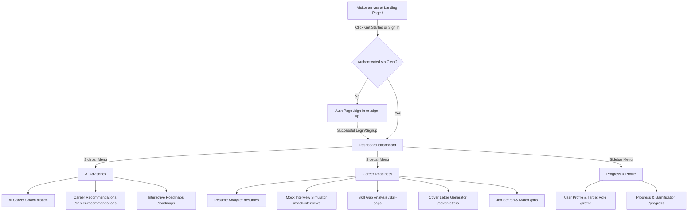
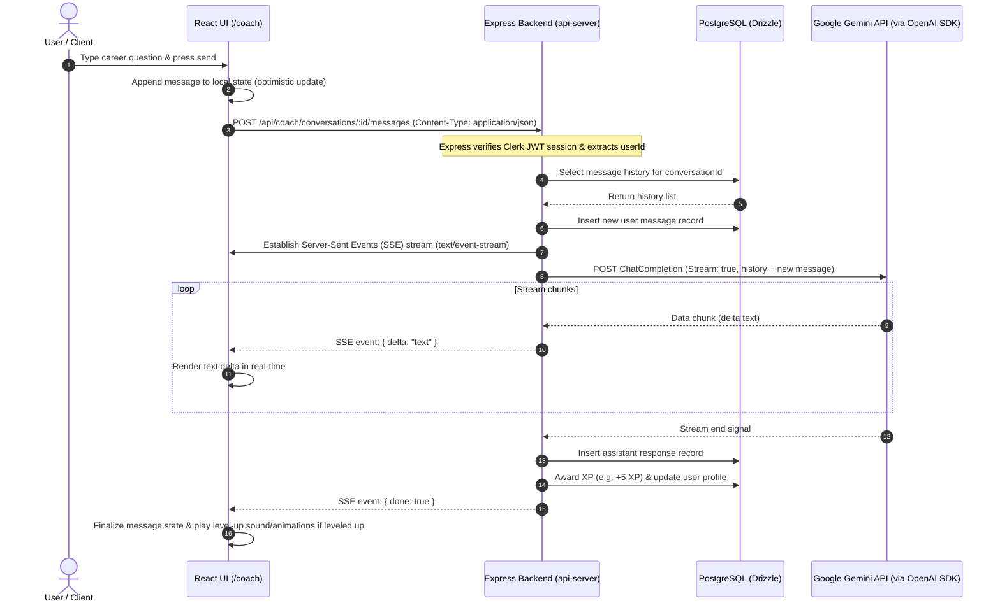
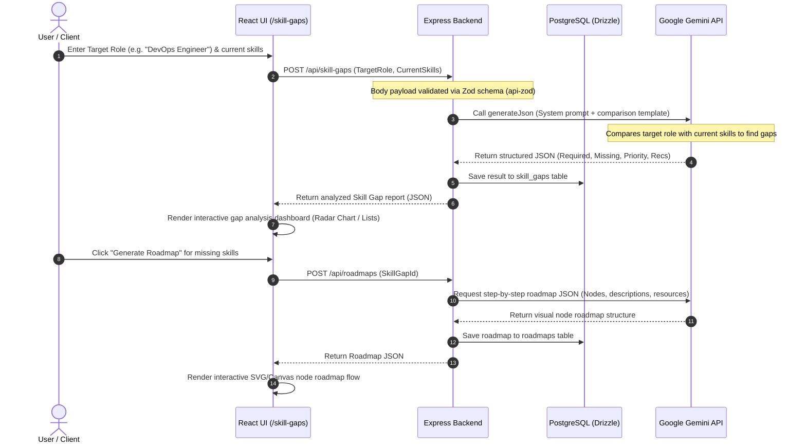
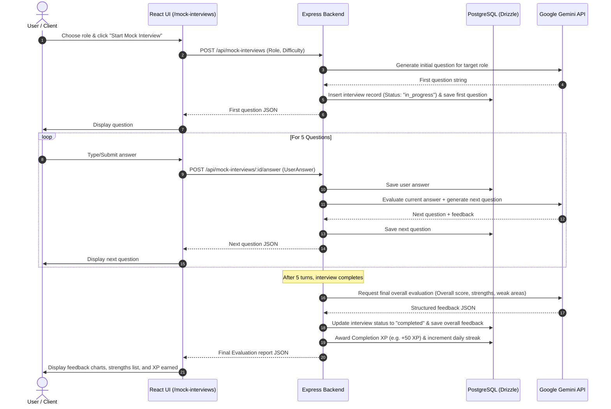

# SkillConnect AI — Detailed System Workflows

This document outlines the detailed user journeys, system architectures, and execution sequences for the core features of **SkillConnect AI** (Visual AI Suite).

---

## 1. User Journey & Feature Navigation Flow

This flowchart illustrates the navigation paths and page access rules within the SkillConnect AI application, including the authentication check via Clerk.

---

## 2. Technical Sequence: AI Career Coach (SSE Streaming)

This sequence diagram illustrates how messages are sent, streamed from the Gemini API (using the OpenAI SDK compatibility layer), stored in the database, and how gamification XP is awarded.

---

## 3. Server-Client Boundary: Skill Gap Analysis & Roadmap Generation

This diagram details the server-client data boundary and backend validation flow during a skill analysis request, followed by the generation of a career learning path.

---

## 4. Interactive Simulation: Mock Interview Session

This diagram details the multi-turn interactive loops that occur during an AI-driven mock interview simulation.

